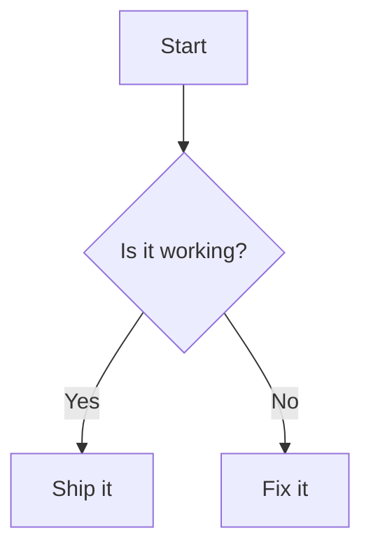

# Writing and formatting

This page covers writing in the K-Doc view, where you see the document formatted and edit it directly. It explains how to format text, build structure such as lists and tables, insert links and pictures, and move around a long document.

K-Doc saves everything you do here as ordinary Markdown. To see the Markdown itself, switch to **Source** or **Split** (see [Getting started](getting-started.md)). The shortcuts on this page are the defaults of the Word keyboard preset; you can change them, and see the full list, in [Keyboard shortcuts](keyboard-shortcuts.md).

## Ways to give a command

Most commands on this page can be reached in several places. Use whichever suits you.

- **Menu bar:** the **Format**, **Insert** and **Table** menus hold the formatting commands. Press `Alt` with the underlined letter to open a menu from the keyboard, for example `Alt+O` for **Format**.
- **Ribbon:** the **Home** tab has the **Font**, **Styles**, **Paragraph** and **Lists** groups, and the **Insert** tab has **Tables**, **Media**, **Links** and **Breaks**. A **Table** tab appears while the caret is in a table. Hover over a ribbon button to see its shortcut. `Ctrl+F1` cycles the ribbon between expanded, collapsed and hidden.
- **Right-click menu:** right-click in the document for Cut, Copy and Paste, plus extra groups that depend on where you clicked: formatting when text is selected, link commands on a link, table commands in a table and picture commands on an image.
- **Slash menu:** type `/` at the start of an empty paragraph (see [Insert blocks with the slash menu](#insert-blocks-with-the-slash-menu)).
- **Command palette:** press `Ctrl+Shift+P` and type part of a command's name. `hed 2` finds **Heading 2**. Commands that cannot run where the caret is are greyed out.

To change what the ribbon shows, see [Customising K-Doc](customising.md).

## Make text bold, italic or another format

Select the text, then use a shortcut or a command from the **Format** menu. Using the same command again removes the format.

| Format | Shortcut | Written in the file as |
| --- | --- | --- |
| **Bold** | `Ctrl+B` | `**text**` |
| **Italic** | `Ctrl+I` | `*text*` |
| **Strikethrough** | `Ctrl+Shift+X` | `~~text~~` |
| **Highlight** | `Ctrl+Alt+H` | `==text==` |
| **Subscript** | `Ctrl+=` | `~text~` |
| **Superscript** | `Ctrl+Shift+=` | `^text^` |
| **Inline Code** | `Ctrl+E` | `` `text` `` |

K-Doc has no underline, because Markdown has no way to write one.

To remove all character formatting from a selection, choose **Format → Clear Formatting** or press `Ctrl+Space`.

## Copy formatting with the format painter

The format painter copies character formatting (bold, italic, strikethrough, inline code, highlight, subscript and superscript) from one place to another. It does not copy links, headings or list formatting.

1. Put the caret in, or select, text that has the formatting you want.
2. Choose **Format → Format Painter** or press `Ctrl+Shift+C`. The pointer changes to show the painter is on.
3. Click a word to paint it, or drag across the text you want to paint.

The painted text gets exactly the copied formatting; any formatting it had before is replaced. Picking up plain text and painting with it clears formatting. Press `Esc` to turn the painter off without painting.

## Add headings

Put the caret in a paragraph and choose a heading level:

- Press `Ctrl+Alt+1` to `Ctrl+Alt+6` for **Heading 1** to **Heading 6**.
- Press `Ctrl+Alt+0` for **Normal Text**, which turns a heading back into a paragraph.
- Use **Format → Headings**, or the **Styles** group on the **Home** tab.

To change the level of an existing heading, use **Format → Headings → Promote Heading** (`Ctrl+Alt+Left`) to make it more important, for example Heading 3 to Heading 2, or **Demote Heading** (`Ctrl+Alt+Right`) to make it less important. Only the heading under the caret changes; the headings below it keep their levels.

## Apply a style from the Styles gallery

The Styles gallery shows each style drawn the way it looks, so you can pick by appearance. Open it with **Format → Styles Gallery** or the gallery button in the **Styles** group on the **Home** tab.

The gallery offers Normal, Heading 1 to Heading 6, Quote, Code Block, the five callouts and a custom callout. The style the caret is in is marked, and styles that cannot apply where the caret is are greyed out. A table cell or list item marks nothing, because none of these styles describes it.

## Move a paragraph or section up and down

Press `Alt+Up` or `Alt+Down` (**Format → Paragraph → Move Block Up** and **Move Block Down**) to move the block under the caret past the one above or below it. The caret moves with the block, so you can press the key repeatedly. This works on top-level blocks; it does not move an item within a list.

To move a heading together with everything under it, drag it in the Outline panel (see [Use the Outline panel](#use-the-outline-panel)).

## Start a new line without a new paragraph

Press `Shift+Enter` to insert a line break inside the current paragraph. In a code block, `Shift+Enter` leaves the block instead.

## Make lists

| List | Shortcut | Menu |
| --- | --- | --- |
| Bullet list | `Ctrl+Shift+8` or `Ctrl+Shift+L` | **Format → Lists → Bullet List** |
| Numbered list | `Ctrl+Shift+7` | **Format → Lists → Numbered List** |

Use the same command again to turn the list back into paragraphs. Press `Enter` for a new item.

To nest an item under the one above it, press `Tab` (**Increase List Level**). To move it back out, press `Shift+Tab` (**Decrease List Level**). The first item of a list cannot be nested, because there is nothing above it to nest under.

**Format → Lists → Multi-level List Gallery** offers bullet, numbered and task lists at three nesting depths, with the one the caret is on marked. Markdown does not record marker styles such as `a.` or `i.`; the program that displays the file chooses the markers, so the gallery offers only what the file can hold.

## Make a task list

Put the caret in a list item and choose **Format → Lists → Task List** or press `Ctrl+Shift+9`. The item becomes an unticked task, written as `- [ ]` in the file. Use the command again to turn it back into an ordinary item.

You cannot tick a task by clicking its box in the K-Doc view. To mark one done, change `[ ]` to `[x]` in the Source view.

## Indent and outdent

**Format → Paragraph → Indent** (`Ctrl+M` or `Ctrl+]`) and **Outdent** (`Ctrl+Shift+M` or `Ctrl+[`) work anywhere. They are also in the **Lists** group on the **Home** tab.

- In a list, Indent nests the item and Outdent lifts it out one level, the same as `Tab` and `Shift+Tab`.
- Outside a list, Indent wraps the paragraph in a block quote, and pressing it again nests another quote. Outdent removes one level of quote. Markdown has no other way to indent a paragraph, so there is no ruler or first-line indent.

## Add a block quote

Choose **Format → Paragraph → Blockquote**, press `Ctrl+Shift+Q`, or type `> ` at the start of a line. Use the command again to remove the quote.

## Add a callout

A callout is a coloured box for a note or warning. Put the caret in a paragraph and choose **Insert → Callout**, then one of **Callout: Note**, **Callout: Tip**, **Callout: Important**, **Callout: Warning** or **Callout: Caution**. To turn a callout back into plain text, choose **Insert → Callout → Remove Callout**.

A callout is written in the file as a block quote whose first line names its kind, the way GitHub and Obsidian write them:

```markdown
> [!WARNING]
> Back up your files first.
```

The `[!WARNING]` line stays visible in the K-Doc view so that what you see matches the file. Other Markdown programs that do not know about callouts show an ordinary quote.

To use a word of your own, such as `[!QUESTION]`, choose the custom callout in the Styles gallery and type the word. It must be letters only. K-Doc shows callouts with words it does not know in grey.

## Add a code block

Choose **Insert → Code Block**, press `Ctrl+Alt+C`, or type three backticks (` ``` `) at the start of an empty line.

To set the block's language, put the caret in it and choose **Insert → Code Block Language…**. Type to filter the list, or type any language name and press `Enter` to use it even if it is not listed. Choose **None (plain text)** to remove the language.

K-Doc colours the code for JavaScript, TypeScript, CSS, HTML and Markdown. Other languages are kept in the file but shown without colour. Hover over a code block, or move the keyboard focus to it, to show a button that copies its contents.

Text you paste inside a code block always goes in as plain characters.

## Insert a horizontal rule

Choose **Insert → Horizontal Rule**, press `Ctrl+Shift+-`, or type `---`, `***` or `___` on an empty line. A horizontal rule also marks where a new slide starts when you present the document.

## Insert a table

- **Insert → Table → Table** (`Ctrl+Alt+T`) inserts a table of three columns and three rows.
- **Insert → Table → Table…** opens a grid at the caret. Choose the size you want.

Press `Tab` to move to the next cell and `Shift+Tab` to move back. Pressing `Tab` in the last cell adds a new row.

A cell can hold formatted text, such as bold, italic, code, strikethrough and links, but not headings, lists, quotes or code blocks; those commands are unavailable while the caret is in a cell. A `|` typed in a cell is saved as `\|`, and a line break in a cell is saved as a space, because Markdown tables cannot hold one. The status bar tells you when this happens.

## Change rows and columns

With the caret in a table, use the **Table** menu, the **Table** ribbon tab or the right-click menu:

- **Table → Row:** **Insert Row Above**, **Insert Row Below**, **Delete Row**, **Duplicate Row**, **Move Row Up** and **Move Row Down**.
- **Table → Column:** **Insert Column Left**, **Insert Column Right**, **Delete Column**, **Duplicate Column**, **Move Column Left** and **Move Column Right**.
- **Table → Delete Table** removes the whole table.

You can also drag the grip on a row's first cell, or on a column's header cell, to move that row or column.

The first row is the header row and always stays first. Markdown tables always have a header, so a table "without" one has an empty header row. **Table → Toggle Header Row** adds an empty header row above the current header, which turns the old header into an ordinary row. Use it again to remove the empty header row, which makes the first ordinary row the header.

## Align and sort table columns

Use **Table → Alignment → Align Column Left**, **Align Column Center** or **Align Column Right** to align the column the caret is in. Markdown aligns whole columns, not single cells.

To sort, put the caret in the column to sort by and choose **Table → Sort → Sort Column Ascending** or **Sort Column Descending**. K-Doc works out whether the column holds numbers, dates or text and sorts accordingly. The header row stays at the top and empty cells go last. Dates are recognised in the form `2026-09-15` or with a month name, such as `15 September 2026`; dates such as `15/09/2026` are sorted as text, because day-first and month-first cannot be told apart.

## Set a column's width

Markdown has no column widths, but it can record a minimum width in characters. Put the caret in a column and choose **Table → Column → Column Width…**, then enter a number from 1 to 200. K-Doc saves it by lengthening the dashes under the header, which every Markdown reader accepts.

## Paste a table from a spreadsheet or web page

Copy cells from Excel, Google Sheets, a Word table, a CSV file or a web page, then paste. If the paste does not come out as a table, use the paste options control that appears at the caret, or **Paste Special**, and choose **Table** (see [Paste in a different form](#paste-in-a-different-form)). K-Doc reads tab-separated, comma-separated and semicolon-separated text, and tables copied from web pages. The first row becomes the header.

When you copy a table, or whole rows of one, from K-Doc, the plain-text copy is tab-separated, so it pastes straight into a spreadsheet.

## Insert a link

Select the text you want to link and choose **Insert → Link** or press `Ctrl+K`. To change a link, put the caret anywhere in it and press `Ctrl+K` again.

The link dialog has three tabs:

- **URL:** type a web address, or click **File…** to link to a file.
- **Heading:** link to a heading in this document.
- **Note:** search the notes in your vault (see [Vaults](vaults.md)).

**Title (optional)** adds a tooltip. Click **Apply** to save the link.

Right-click a link for **Open Link**, **Edit Link…** and **Remove Link**. With text selected and no link, the right-click menu offers **Add Link…**.

## Follow a link

Hover over a link to see a card showing where it goes. Click **Open** on the card, or hold `Ctrl` and click the link, to follow it.

- A link to a heading scrolls to that heading.
- A link to a note opens the note.
- A web or email link opens in your browser or mail program. Before opening a link to a website you have not marked as trusted, K-Doc asks whether to open it once, always trust that site, or cancel. You can turn this question off in Settings (see [Settings reference](settings-reference.md)).

K-Doc only opens `http`, `https` and `mailto` links outside the document. Links of any other kind are blocked and the card says so.

Press `Alt+Left` (**Edit → Go Back**) to return to where you were before following a link, and `Alt+Right` (**Edit → Go Forward**) to go forward again.

## Use reference-style links

K-Doc shows reference-style links (`[text][1]`) as ordinary links that you can hover and follow. The definitions they point to (`[1]: https://example.com`) are shown as their source text; edit them in the Source view.

To rewrite every inline link in the document as a reference link with its definition at the end, choose **File → Vault → Convert to Reference Links**. **File → Vault → Link Definitions** opens a panel that lists each definition and how often it is used.

## Insert a picture

Choose **Insert → Image…** or press `Ctrl+Shift+I`. In the dialog:

- **Source:** type a web address or a path to a file, or click **Choose file…**.
- **Alt text:** a description read aloud by screen readers and shown when the picture cannot load.
- **Caption (optional):** shown under the picture.

You can also paste a picture or drag an image file into the document. In a saved document, K-Doc copies the picture into an attachments folder next to the document and links to it with a relative path, so the document and its pictures move together. The folder name and file names are set in Settings (see [Settings reference](settings-reference.md)). In a document that has never been saved, a dropped picture keeps the path it came from. Dragging in any other kind of file, such as a PDF, inserts a link to it.

A picture with a relative path, such as `images/chart.png`, is found relative to the document's own folder. K-Doc shows PNG, JPEG, GIF, WebP, SVG, BMP, ICO and AVIF pictures up to 25 MB. Wiki-style picture embeds such as `![[chart.png]]` are shown as pictures too.

To change a picture's address, alt text or caption, right-click it and choose **Edit Image…**.

## Resize a picture

Click a picture to select it, then drag the handle at its corner. The height follows the width.

To resize without a mouse, select the picture and press `Alt+Shift+Right` to make it a tenth wider or `Alt+Shift+Left` to make it a tenth narrower. These are also in **Format → Image Size** as **Widen Image** and **Narrow Image**. **Reset Image Size** returns the picture to its natural size.

K-Doc saves the width in the picture's alt text, as in `` or `![[chart.png|600]]`.

## Add video or audio

Markdown has no syntax for video, so K-Doc turns a link into a player. Put a link or image to a media file, or to a YouTube or Vimeo video, on a paragraph of its own:

```markdown
[Product demo](videos/demo.mp4)

https://www.youtube.com/watch?v=VIDEO_ID
```

K-Doc plays MP4, M4V, WebM, OGV and MOV video, and MP3, M4A, WAV, OGG, OGA, FLAC and AAC audio. A local file can be up to 64 MB. A YouTube or Vimeo link shows a card with a **Play** button; nothing is fetched from the site until you press it. A link inside a sentence stays an ordinary link.

## Add a footnote

Put the caret where the footnote mark should go and choose **Insert → Footnote** (also in the **Links** group on the **Insert** tab). K-Doc adds the next free number at the caret, adds the note at the end of the document and puts the caret in the note so you can type it.

Click a footnote mark to jump to its note, and click the note's label to jump back.

## Insert a table of contents

Put the caret where the contents list should go and choose **Insert → Table of Contents → Table of Contents…**. Enter how many heading levels to include (3 unless you change it). K-Doc inserts a list of links to the headings.

The list does not update by itself. After changing headings, choose **Insert → Table of Contents → Table of Contents…** again, or **Refresh Table of Contents**, to bring it up to date. The list is written between two hidden comments, `<!-- toc -->` and `<!-- /toc -->`, which is how K-Doc finds it again.

## Draw a diagram

Write a code block whose language is `mermaid`, and K-Doc draws it as a diagram using [Mermaid](https://mermaid.js.org/) syntax:

````markdown

````

In the K-Doc view you see only the diagram. Click it, or move the caret into it, to show its code above a preview that redraws as you type. Move the caret out of the block to show the diagram alone again.

If the code has a mistake, Mermaid's message appears under the diagram, and the last diagram that worked stays in place until you fix it. Diagrams follow the light or dark theme. The file keeps the code block exactly as you wrote it, so other Markdown tools can read it.

## Write maths

K-Doc keeps inline maths (`$E = mc^2$`) and maths blocks (`$$ ... $$`) exactly as written. The K-Doc view shows them as their source text rather than as formatted equations; edit them in the Source view.

## Align a paragraph or heading

Markdown cannot centre or right-align text, but HTML can. Before K-Doc will write that HTML, turn on **Settings → Editor → Allow HTML formatting**. While it is off, the alignment commands tell you so and change nothing.

Once it is on, use **Format → Alignment → Align Left**, **Align Centre**, **Align Right** or **Remove Alignment**, or the alignment buttons in the **Paragraph** group on the **Home** tab. Alignment works on paragraphs and headings only, not on lists, tables or code blocks.

K-Doc saves an aligned paragraph like this, which GitHub, Obsidian and Pandoc all understand:

```markdown
<div align="center">

Centred, and **still Markdown**.

</div>
```

## Work with raw HTML

HTML written in a document, such as a `<details>` block or a `<span>`, appears in the K-Doc view as a small code editor labelled **HTML**, with colouring. Click into it to edit the HTML directly. Press `Esc` to leave it, or use the arrow keys at its first or last character. `Ctrl+Z` and `Ctrl+Y` undo and redo in the document as usual.

## Use Markdown shortcuts as you type

You can type Markdown and K-Doc formats it as you go. Block shortcuts work at the start of an empty line; inline shortcuts take effect when you type the closing character.

| Type | Becomes |
| --- | --- |
| `# ` to `###### ` | Heading 1 to Heading 6 |
| `- `, `+ ` or `* ` | Bullet list |
| `1. ` | Numbered list (any number starts the list at that number) |
| `> ` | Block quote |
| ` ``` ` | Code block |
| `---`, `***` or `___` | Horizontal rule |
| `**text**` | **Bold** |
| `*text*` | *Italic* |
| `~~text~~` | Strikethrough |
| `==text==` | Highlight |
| `~text~` | Subscript |
| `^text^` | Superscript |
| `` `text` `` | Inline code |

If a shortcut fires when you did not want it, press `Backspace` straight away to get back exactly what you typed. Markdown that you paste is not reformatted by these shortcuts.

## Insert blocks with the slash menu

Type `/` at the start of an empty paragraph to open the slash menu. Keep typing to filter it, then choose an item with the arrow keys and `Enter`, or click it. The menu offers **Heading 1**, **Heading 2**, **Heading 3**, **Bullet List**, **Numbered List**, **Task List**, **Code Block**, **Quote**, **Table** and **Divider**. Each item shows its Markdown shortcut beside it.

The `/` and anything you typed after it are removed when you choose an item. The menu closes on its own if you type anything else.

## Let K-Doc correct your typing

As you type in the K-Doc view, K-Doc can make these corrections. Each one is a separate switch in **Settings → Editor**:

| Setting | What it does | On at first |
| --- | --- | --- |
| **Smart quotes** | Changes straight quotes to curly quotes | Yes |
| **Dashes (-- and spaced -)** | Changes `word--` to an em dash, and a spaced `-` or `--` to an en dash | Yes |
| **Ellipsis (...)** | Changes `...` to `…` | Yes |
| **Replace text as you type** | Applies the replacement table, for example `(c)` to `©` and `teh` to `the` | Yes |
| **Ordinal superscripts (1st)** | Raises the letters in `1st`, `22nd` and so on | No |
| **Capitalise sentences** | Capitalises the first letter of a sentence | No |

**Smart substitutions** turns all of them on or off together. None of them apply inside code. If a correction is not what you wanted, press `Backspace` straight away to undo it.

To edit the replacement table, choose **Tools → Autocorrect Replacements…** or click **Edit…** beside **Replacement table** in **Settings → Editor**. Type the text to replace and its replacement, then click **Add**. **Restore Defaults** puts back the original table.

## Insert text with snippets

A snippet is a short word that expands into longer text. Type the snippet's prefix and press `Tab`. K-Doc comes with these:

| Prefix | Inserts |
| --- | --- |
| `code` | A code block |
| `img` | A picture |
| `link` | A link |
| `note` | A note callout |
| `table` | A two-column table |
| `task` | A task list item |
| `today` | Today's date |

After a snippet expands, the first placeholder is selected. Type over it, then press `Tab` to move to the next placeholder or `Shift+Tab` to go back. Press `Esc` to stop.

To add or change snippets, choose **Tools → Snippets…** or click **Edit…** beside **Snippet list** in **Settings → Editor**. In a snippet's text:

- `$1`, `$2` and so on mark the places `Tab` moves to, in order.
- `${1:default}` marks a place and fills it with text you can type over.
- `$0` marks where the caret ends up.
- `$DATE` and `$TIME` insert the current date and time.
- `\$` inserts a dollar sign.

For example, `**${1:Name}:** $0` inserts a bold label, selects `Name` for you to replace, then moves on. Snippets work in the K-Doc view only. Turn them off with **Snippets (prefix + Tab)** in **Settings → Editor**.

## Type in several places at once

In the K-Doc view:

- Hold `Ctrl` and click to add another caret. Text you type, and `Backspace`, then apply at every caret.
- Press `Ctrl+D` to select the word under the caret. Press it again to add a caret at the next place the same whole word appears.
- Press `Esc` to go back to one caret.

`Enter` and the arrow keys act on the main caret only. `Ctrl` and click on a link follows the link instead of adding a caret.

In the Source view, `Ctrl+Click` and `Ctrl+D` work the same way, and you can hold `Alt` and drag to select a column of text.

## Fold sections and list items

Hover to the left of a heading to show a ▾ button. Click it to hide the heading's section; click ▸ to show it again. A list item with more than one paragraph can be folded the same way. A folded heading ends with `…`.

**View → Folding** has **Toggle Fold**, which folds or unfolds the place where the caret is, **Fold All Headings** and **Unfold All**.

Folding does not change the document. Folds are the same in the K-Doc and Source views and K-Doc remembers them for each file. If you move into folded text, for example by finding a match there, the section unfolds.

## Find and replace text

Press `Ctrl+F` (**Edit → Find**) to open the find bar, or `Ctrl+H` (**Edit → Replace**) to open it with the replace row. Every match is highlighted in the document and marked on the scroll bar. Press `Enter` for the next match and `Shift+Enter` for the previous one.

The buttons beside the search box narrow the search:

| Button | What it does |
| --- | --- |
| **Case** | Matches upper and lower case exactly |
| **Word** | Matches whole words only |
| **Regex** | Treats the search as a regular expression |
| **No code** | Skips code blocks and inline code |
| **No URLs** | Skips the addresses inside links |
| **Section** | Searches only the heading section the caret is in |
| **In selection** | Searches only the text that was selected when you turned it on |

Type the new text in **Replace**, then click **Replace** for the current match or **Replace all** for every match. A **Replace all** is undone with a single `Ctrl+Z`.

With **Regex** on, you can use parts of the match in the replacement: `$1` to `$9` insert the matching groups, `$&` inserts the whole match, and `$$` inserts a dollar sign. For example, searching for `(\w+), (\w+)` and replacing with `$2 $1` changes `Smith, Jane` to `Jane Smith`.

Find searches the document's Markdown, not just the words you see. You can search for Markdown itself, such as `**`, and a match can include formatting characters.

To search every note in a vault, see [Vaults](vaults.md).

## Go to a heading or line

Press `Ctrl+G` (**Edit → Go To**). In the K-Doc view, K-Doc lists the document's headings; type to filter them and press `Enter` to jump. In the Source view it asks for a line number instead. You can type `12` for line 12, or `12:5` for line 12, column 5.

## Use the Outline panel

The Outline panel lists the document's headings in the left sidebar. Open or close it with **View → Panels → Toggle Outline**.

- Click a heading to jump to it.
- Click the arrow beside a heading to collapse or expand the headings under it in the panel.
- Drag a heading to a new place to move its whole section, including everything under it.

The outline lists top-level headings only, not headings inside quotes or lists.

## Write without distractions

These modes are in the **View** menu, and **Focus Mode: Paragraph** and **Zen Mode** are also in the **Focus** group on the **View** ribbon tab. Choose a mode again to turn it off. K-Doc does not remember them after you close it.

- **View → Focus Mode → Focus Mode: Paragraph** dims everything except the paragraph you are writing.
- **View → Focus Mode → Focus Mode: Sentence** dims everything except the sentence you are writing.
- **View → Typewriter Mode** keeps the line you are typing in the middle of the window.
- **View → Zen Mode** hides everything except the document and makes the window full screen. Press `Esc` to leave.

## Paste in a different form

When you paste, K-Doc keeps the formatting it can write as Markdown and drops anything else. Plain text that looks like Markdown is read as Markdown, so pasting `## Results` gives you a heading.

After a paste, a small control appears at the caret offering other ways to read what you pasted. You can also choose **Edit → Paste Special → Paste Special** or press `Ctrl+Alt+V` to open the full dialog. The choices are:

- **Unformatted Text:** the characters only, with no headings, emphasis or links.
- **Markdown:** the text read as Markdown.
- **Formatted (HTML):** the copied formatting converted into Markdown.
- **Table:** tab- or comma-separated text, or a copied table, as a table.

Only the choices that suit what you copied are offered. Choosing one replaces what you just pasted. If you open Paste Special before pasting, your next paste uses the form you choose.

To paste plain text straight away, press `Ctrl+Shift+V` (**Edit → Paste Special → Paste as Plain Text**).

To copy a selection as Markdown source or as HTML, for example to paste into an email or a web form, choose **Edit → Copy as Markdown** or **Edit → Copy as HTML**.

## Undo and redo

Press `Ctrl+Z` to undo and `Ctrl+Y` or `Ctrl+Shift+Z` to redo, or use **Edit → Undo** and **Edit → Redo**.

The K-Doc and Source views share one undo history. You can make a change in one view and undo it from the other, and switching views does not lose any history.

## See also

- [Getting started](getting-started.md)
- [Reviewing](reviewing.md)
- [Vaults](vaults.md)
- [Export and print](export-and-print.md)
- [Customising K-Doc](customising.md)
- [Settings reference](settings-reference.md)
- [Keyboard shortcuts](keyboard-shortcuts.md)
- [Troubleshooting](troubleshooting.md)
